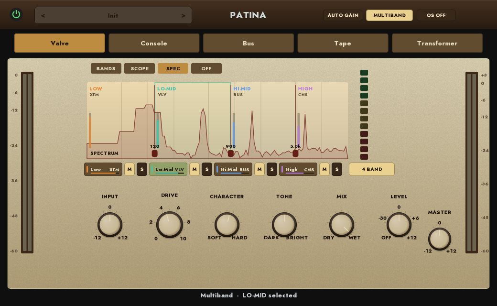

# Patina

A five-model saturation plugin for Linux, in the same visual language as Comp
Suite. Patina runs as a quick single-band saturator or as a two-, three- or
four-band multiband colour box with a different model per band. GPL-3.0-or-later.

CLAP and LV2 bundles are built and installable.



## Models

| Tab | Character |
|---|---|
| **Valve** | two-stage tube warmth, even and odd harmonics |
| **Console** | channel-strip saturation, dual-mono with small L/R differences |
| **Bus** | stereo-linked, gentle even-order glue |
| **Tape** | head bump, soft tape compression and HF loss |
| **Transformer** | iron low-end saturation, dark and thick |

## Controls

Single-band: Drive · Character · Tone · Mix · Output · Auto Gain ·
Oversampling (Off/2×/4×). The display switches between **Shape** (transfer
curve), **Scope** (input vs shaped sine), **Spec** (FFT spectrum) and **Off**.

### Multiband

Switch on **Multiband** for two, three or four bands with Linkwitz-Riley
4th-order crossovers (defaults 120 Hz, 900 Hz and 5 kHz, draggable in the
display):

- A band-count pill switches between **2, 3 and 4 bands**. Two bands use the
  900 Hz split and merge the middle regions into Low/High; three bands use
  120 Hz and 5 kHz and merge the two middle regions into Mid; four bands use
  all three crossovers.
- Every band has its own **model**, **input**, **drive**, **character**,
  **tone**, **mix**, **level**, mute and solo.
- **Level** runs from silence (0) through 0 dB to +12 dB, so a band can be
  faded fully out or pushed hard.
- The model tabs and knobs edit the selected band; the band row switches
  between the active bands.
- **Bands** shows the active band regions, live band meters, crossover
  handles and the input FFT spectrum. **Scope** draws the selected band's shaped waveform.
  **Spec** shows the spectrum full-size. **Off** hides the overlays.
- The spectrum is a 2048-point FFT analysed every 1024 samples, mapped to 128
  log-spaced bins from 20 Hz to 20 kHz.
- The master **Output**, Auto Gain and oversampling are global.
- Switching from single-band seeds all four bands with the current sound;
  switching back carries the selected band into single-band mode.

## LV2

The LV2 bundle is `patina.lv2`, with the plugin URI
`https://github.com/tylorismusic-commits/patina` and an X11 UI. The 48
parameters are control ports, followed by band meters, peak/VU meters, 128
FFT spectrum bins and a `lv2:latency` port. Fourteen factory presets are
generated into `presets.ttl` from the same tables as the CLAP presets.

## Shared DSP

Filters, ADAA shaping, oversampling, the Linkwitz-Riley crossovers, the FFT
spectrum analyser and the meter helpers come from
[`hearth-dsp`](https://github.com/tylorismusic-commits/hearth-dsp) 0.3.0,
consumed as a submodule. No DSP code is copied from Comp Suite.

## Install

```sh
tar xzf Patina-<version>-clap.tar.gz -C ~/.clap
tar xzf patina-<version>-lv2.tar.gz -C ~/.lv2
```

Restart the host or rescan CLAP/LV2 plugins. REAPER scans both user
directories at startup.

## Typed values

Right-click any knob to open a value field. Type a value with its unit, such
as `-6 dB`, `50%`, `1.2k`, or a model / mode name, then press Enter to commit
or Escape to cancel.

## Build

```sh
git submodule update --init --recursive
cmake -S . -B build -DCLAP_DIR="$HOME/.clap" -DLV2_DIR="$HOME/.lv2"
cmake --build build -j
ctest --test-dir build --output-on-failure
cmake --install build
```

The CLAP and LV2 host smoke tests run under `xvfb-run` and drive every model,
the oversampling latency handshake, state save/load, the LV2 UI handshake and
the embedded editor.

Render the panel previews:

```sh
./build/patina_preview assets/fonts docs
```

## Status

- [x] Five-model saturation engine with ADAA and Off/2×/4× oversampling
- [x] Panel in the Comp Suite visual language (shape/scope/spectrum displays)
- [x] Factory presets
- [x] DSP tests
- [x] Two-, three- and four-band multiband modes with per-band models and
  crossovers
- [x] Real-time FFT spectrum display
- [x] CLAP
- [x] LV2 with an X11/Cairo editor
- [x] Host/state/latency integration

The previews, CLAP editor and LV2 editor render from the same Panel class. Multiband
previews are in `docs/patina-mb-low.png`, `patina-mb-lomid.png`,
`patina-mb-himid.png`, `patina-mb-high.png`, `patina-mb-2band.png`,
`patina-mb-3band.png`, `patina-mb-scope.png` and `patina-mb-spectrum.png`;
the single-band spectrum is `docs/patina-spectrum.png`.

## Licence

GPL-3.0-or-later. See `THIRD_PARTY_NOTICES.md`.

## Changelog

See `CHANGELOG.md`.
